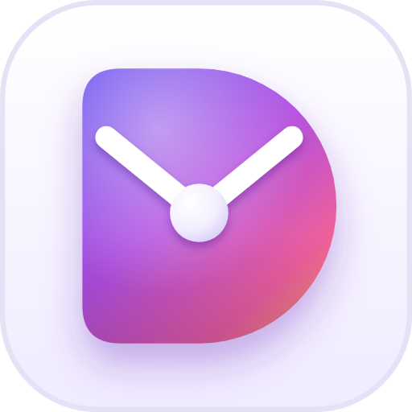

<p align="center">
  
</p>

<h1 align="center">Deciary</h1>
<p align="center"><em>Letters to future you.</em></p>

Deciary is a private, offline decision diary. You write down a decision and what you expect to happen, seal it like a letter, and open it later to see how it really went.

This repository holds the **Android app** (Kotlin, Jetpack Compose) and the **v2 design** it is built from: interactive screen mockups, the logo, artwork and the design notes.

## The app

A native Android app in Kotlin with Jetpack Compose and Material 3. Min SDK 26 (Android 8), target SDK 35.

- **Portrait only**, as designed.
- **Offline by design.** The app has no `INTERNET` permission, Android cloud backup is switched off, and letters live in one JSON file in the app's private storage.
- **Writing a letter:** the decision and your choice (required), then your prediction and why, mood, when it opens, and how sure you are (50–100%). "Skip the rest" seals it at any point after the first step. Optional challenge questions come before sealing.
- **Sealed means sealed.** The prediction and how sure you were are locked; a typo fix is allowed for 10 minutes.
- **Opening a letter:** "Then & now" puts your prediction next to what happened, three quick questions suggest a verdict (Earned it, Bad luck, Lucky break, Lesson), and you stamp it.
- **Your shelf:** all letters by month, filtered by sealed or opened.
- **Lock:** optional 4-digit PIN (salted PBKDF2 hash). With it on, the fingerprint is offered whenever the phone has one set up. The diary locks when you tap the cover and every time you leave the app (except for the backup file picker), each letter asks for the fingerprint or PIN again before it shows, and the app is hidden from the recent-apps preview.
- **Reminders:** a daily check at the hour you pick (WorkManager). Notifications never show a letter's title.
- **Your data:** backups are one file encrypted with a password you choose (AES-GCM, PBKDF2 key). Restore, and delete everything (PIN plus typing DELETE). There is no unencrypted export, so your letters never leave the phone as readable text.
- **Safety:** if a letter's words suggest someone may be in crisis, a calm sheet offers the Tele-MANAS helpline (14416) and switches challenge questions off. Saving is never blocked.
- **Look:** the design's colour tokens in light and dark, Fraunces and Noto Sans bundled, stitched leather covers and soft 3D scene art drawn in Compose, Fluent Emoji for the four verdict objects.

### Build and run

Open the project in Android Studio (Ladybug or newer) and run the `app` configuration, or from the command line:

```sh
./gradlew assembleDebug        # app/build/outputs/apk/debug/app-debug.apk
./gradlew testDebugUnitTest    # unit tests for verdicts, backups, encryption and the safety check
```

Every push builds debug and release APKs on GitHub Actions (`.github/workflows/android.yml`); download them from the run's **deciary-apks** artifact. The release APK is signed with the debug key so it installs for testing; set up your own signing before publishing.

### Code map

| Path | What it does |
| --- | --- |
| `app/src/main/java/app/deciary/data/` | Letter model, JSON store, settings and PIN, encrypted backup, safety check |
| `app/src/main/java/app/deciary/ui/screens/` | One file per flow: welcome, cover, lock, home, write, seal, letter and review, shelf, settings, data |
| `app/src/main/java/app/deciary/ui/components/` | Leather cover, snap, wax seal, buttons, cards, chips |
| `app/src/main/java/app/deciary/ui/theme/` | Colour tokens, mood colours and type |
| `app/src/main/java/app/deciary/reminders/` | Daily due-letter check and notification |

## Design files

| Folder | Contents |
| --- | --- |
| `brand/` | App icon (light and night, SVG and PNG) and the three leather cover options |
| `design/screens/` | 19 interactive screen mockups (`.dc.html`) |
| `design/img/` | 3D artwork used in the screens |
| `design/tools/leathergen.py` | Generates the stitched leather cover as SVG |
| `design/canvas.json` | Layout of the screens on the design canvas |
| `docs/DESIGN.md` | Summary of the design system and decisions |
| `docs/ROADMAP.md` | Planned features, starting with decision-type tags |

The living design canvas and the full design document are on claude.ai (private links, owner access only).

## Screens

| Flow | Screens |
| --- | --- |
| First run | Welcome (3 slides) · Cover setup · Home on first launch |
| Home | Home · Home at night · Lock screen |
| Writing a letter | How sure are you · Challenge questions · Sealed |
| Opening a letter | Letter · Then & now · Verdict |
| Shelf and control | Your shelf · Settings · Your data |
| Edge states | Five letters due with reminders off · Restore with wrong password · Safety sheet |

The `.dc.html` files are Design Component sources made for the claude.ai design canvas. They use its runtime (`support.js`), so they don't open as plain web pages.

## Look and feel

- **Colours:** lilac paper `#F5F2FB`, deep violet ink `#1D1A33`, violet accent `#6E4FE6`, rose seals `#C23C72`.
- **Type:** Fraunces for headings, Noto Sans for text.
- **Diary cover:** stitched leather in Ink (rose-gold snap), Plum (silver snap) or Natural tan (brass snap). The name is pressed into the leather, and tapping the cover locks the diary.
- **Icon:** a D-shaped envelope whose flap and seal read as clock hands.

## Credits

- Verdict artwork: [Microsoft Fluent Emoji](https://github.com/microsoft/fluentui-emoji), MIT licence. The mockups in `design/` use more of the set.
- Icons: [Material Symbols Rounded](https://fonts.google.com/icons) by Google, Apache 2.0 licence.
- Fonts: [Fraunces](https://fonts.google.com/specimen/Fraunces) and [Noto Sans](https://fonts.google.com/noto/specimen/Noto+Sans), SIL Open Font Licence.
